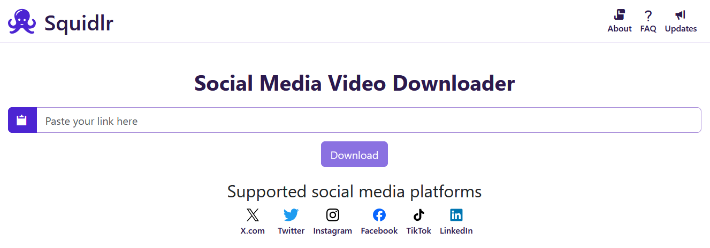
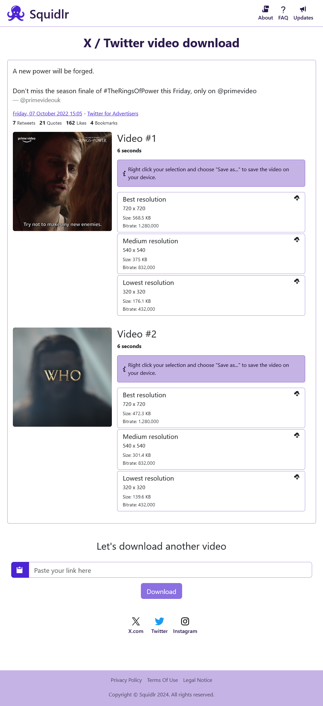

> [!IMPORTANT]
> **Squidlr has been discontinued.** Due to my focus on family and work I no longer have enough time to keep developing and hosting Squidlr. On top of that, keeping a web-based video download service working is hard, as social media platforms keep changing all the time.
>
> www.squidlr.com is now a static website. If you want to download videos, have a look at [yt-dlp](https://github.com/yt-dlp/yt-dlp) on desktop or the [Seal](https://github.com/JunkFood02/Seal) app on Android.
>
> The source code stays available here for anyone interested in how Squidlr worked.



<details>
<summary><strong>additional screenshots</strong></summary>



</details>

## What is Squidlr?
Squidlr is a platform to easily download videos and GIFs from various social media and video platforms.

It's composed of a SPA (single page application) website and an API server and is open source software.

## Features
- Download videos from:
  - Facebook
  - Instagram
  - LinkedIn
  - TikTok
  - X (f.k.a Twitter)
- choose between available video file resolutions
- support of multiple videos found in a single post
- display of common meta data attached to the post (likes, shares, author, etc.)
- no ads
- fast

## Motivation
Squidlr was created out of a need for a better user experience. Many existing download services suffer from issues such as excessive advertisements, slow performance, and an overall unsatisfactory user interface. As the creator of Squidlr, I wanted to offer a platform that is free, fast, and provides a superior user experience compared to other services.

Additionally I wanted to use and learn the functionality of Blazor, a SPA library, which is part of the ASP.NET Core Framework from Microsoft.

## How do I use Squidlr?
The hosted service at https://www.squidlr.com/ has been shut down. You can still build and run Squidlr locally (see below), but the platform integrations are no longer maintained and may break at any time.

## Build and use locally
If you want to use Squidlr on your local machine you have to download the source code or clone the complete repository with Git:

```shell
git clone https://github.com/rgueldenpfennig/Squidlr.git
```

After that you can open the solution file `Squidlr.sln` with Visual Studio or another IDE (e.g. JetBrains Rider).

To run both the website and the API you need to make sure to set the `APPLICATION__APIKEY` environment variable to a value of your choice. Otherwise the web server won't be allowed to communicate with the backend API.

You can also use Docker compose to get both components up and running quite easily. Just execute the command in the root directory:
```shell
docker-compose up -d
```

Either way you can access the frontend by navigating to http://localhost:8091/ after everything is up and running.

## Contributing
If you want to contribute you are welcome to create a pull request targeting the `dev` branch or simply open up an issue.

## Deployment and hosting
The Azure hosting has been discontinued. www.squidlr.com is now a static website located in the [`deprecated`](/deprecated) folder and deployed to GitHub Pages by the `deployment-pages` GitHub Actions workflow.

The former Azure workflows (`deployment-api`, `deployment-web`, `infrastructure-*`) are kept for reference, but their automatic triggers are disabled.

## Mobile App
I also started to develop a mobile app version of Squidlr based on .NET MAUI. Depending on my free resources I would love to explore that endeavour and publish Squidlr as an app on Android and iOS devices. As the whole logic would be hosted by the client device there won't be any need to communicate with a server but the targeted social media platforms. This means the HTTP request pipeline will be under total control outside of the restriction of modern web browsers. So, it would be possible to directly download TikTok videos for example, instead of using a proxy video streaming server. Additionally it won't be necessary to use a HTTP proxy, which is currently required to crawl Instagram from the backend APIs.
